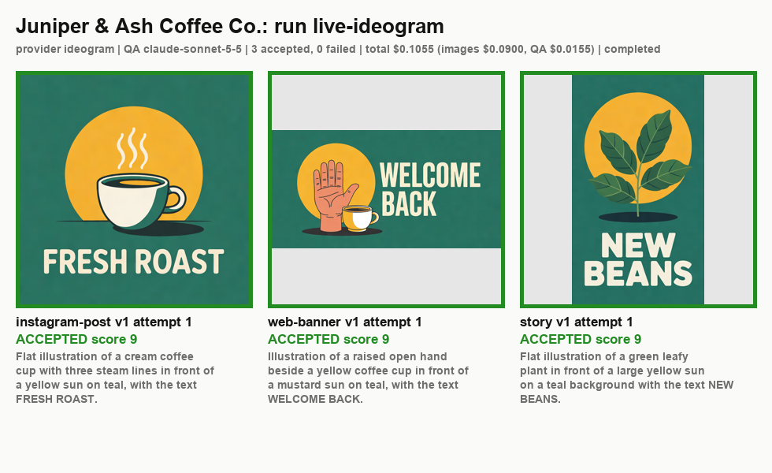
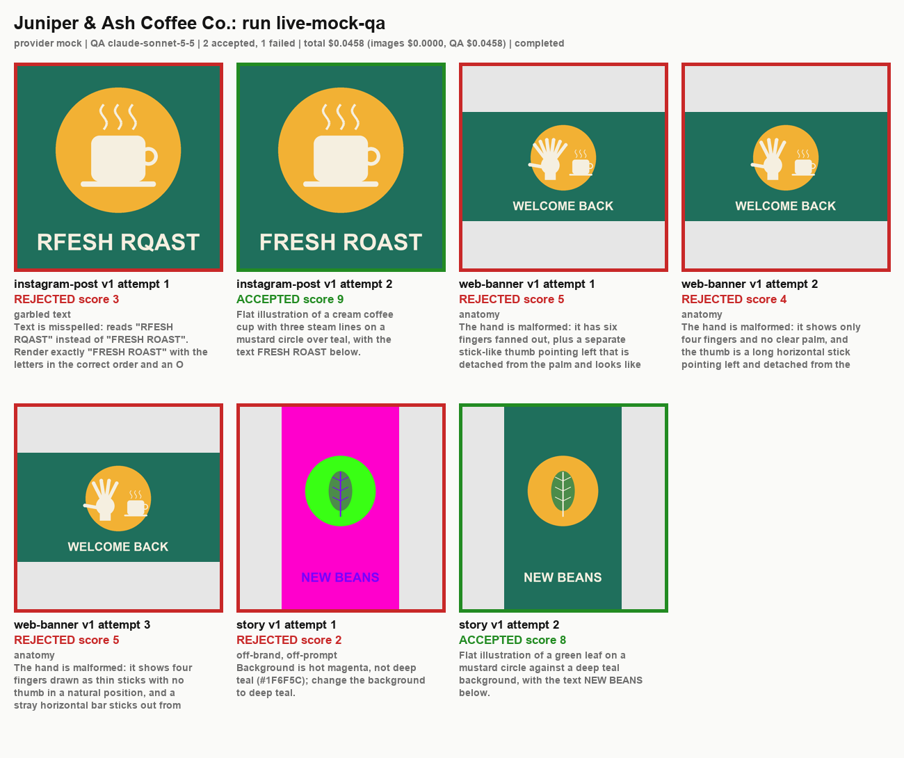
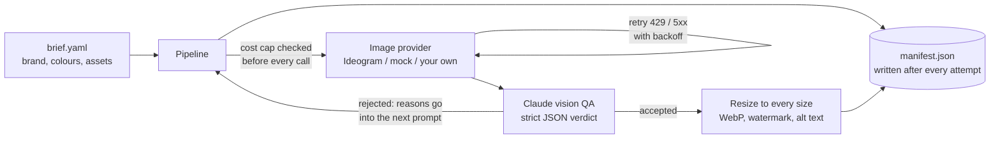

# AI Media Pipeline

Batch AI image generation that a business can actually rely on. A brief file lists the images a brand needs (prompt, required text, sizes). The pipeline generates each one through a pluggable image provider, has **Claude check every image** (does it match the prompt, is the text spelled right, are there extra fingers or limbs, are the brand colours there), regenerates rejected images with Claude's reasons fed back into the prompt, then resizes the keepers to every target size as WebP with an optional watermark and Claude-written alt text. A **hard cost cap** is checked before every paid call, and a `manifest.json` records every attempt, verdict and cent spent.



*A live run on 4 November 2026: Ideogram 3.0 made the three images from `examples/brief.yaml`, Claude passed each one, total cost $0.1055. Below, a run with deliberately broken images shows Claude rejecting them and the pipeline regenerating.*



## How it works



1. **Brief.** YAML or JSON with the brand name, hex colours, style notes, an optional watermark, and a list of assets (prompt, exact text to show, one or more sizes, how many variants). It is validated up front and every problem is reported at once, so a typo fails in a second, not after money has been spent.
2. **Cost cap.** Before each generation the provider's price plus a QA estimate is checked against `--max-cost`; the cap is re-checked before every retry. If the next call would go over, the run stops cleanly and the manifest says why. For Ideogram the price comes from the API itself (a free `dry_run` quote), with a fallback table if the quote fails.
3. **Generate.** Rate limits, timeouts and 5xx are retried with exponential backoff and jitter. An empty wallet (402) or a bad key (401) stops the whole run immediately, because every later call would fail the same way.
4. **Claude QA.** Each image goes to `claude-sonnet-5-5` with the prompt, brand colours and required text. Claude returns a fixed JSON schema (structured output): matches prompt, garbled text, text it actually read, anatomy problems, brand colours present, a 1 to 10 score, reasons, and alt text. **Whether the image passes is decided in code** from those fields (`qa.decide`), so the rule is explicit and tested. An unreadable or refused review never approves an image.
5. **Regenerate.** A rejection turns into concrete instructions for the next attempt ("the text read RFESH RQAST; it must read exactly FRESH ROAST..."), up to `--max-attempts`. After that the image is marked failed and the run moves on.
6. **Post-process.** Accepted images are centre-cropped (never stretched) to every target size, saved as WebP (and PNG with `--png`), watermarked if the brief asks, and the alt text is stored.
7. **Record.** `manifest.json` is rewritten atomically after every attempt, so a crash or Ctrl-C leaves an accurate record of what was made and what it cost. `--contact-sheet` draws every attempt and verdict on one PNG.

## Run it

```bash
python3 -m venv .venv && source .venv/bin/activate
pip install -r requirements.txt -r requirements-dev.txt

# Offline, free: mock provider, no QA
python -m media_pipeline run examples/brief.yaml --provider mock --no-qa --max-cost 0 --contact-sheet

# Mock images with deliberate defects, checked by real Claude (a few cents)
export ANTHROPIC_API_KEY=...
python -m media_pipeline run examples/brief.yaml --provider mock --max-cost 0.30 \
    --inject-defect instagram-post:garbled_text --inject-defect web-banner:extra_fingers \
    --inject-defect story:off_brand_colours --contact-sheet

# Real images from Ideogram 3.0 (turbo is about $0.03 per image)
export IDEOGRAM_API_KEY=...
python -m media_pipeline run examples/brief.yaml --provider ideogram --speed turbo --max-cost 0.60 --contact-sheet
```

On macOS the keys can stay in the Keychain: set `ANTHROPIC_KEYCHAIN_SERVICE` / `IDEOGRAM_KEYCHAIN_SERVICE` to the item names and they are read at run time, never written to disk or logged.

Useful options: `--max-attempts` (default 3), `--retries` (default 3), `--min-score` (default 7), `--speed turbo|default|quality`, `--png`, `--seed`, `--run-id`.

### Add a provider

Subclass `ImageProvider` (`media_pipeline/providers/base.py`): `estimate_cost(request)` must return the price **before** the call, and `generate(request)` returns the image bytes and the real cost, or raises one of the typed errors (`TransientProviderError` is retried, `AuthenticationError` and `InsufficientFundsError` stop the run, `ContentRejectedError` counts as a failed attempt). The Ideogram provider is about 180 lines and is the worked example.

## Tests

`pytest` runs 79 tests with no network and no keys (Ideogram mocked with `responses`, Claude with a fake client):

- **Brief:** both example files load, every validation error is reported together, sizes and colours are normalised, bad files fail cleanly.
- **Ideogram:** the exact multipart request (aspect ratio, seed, brand palette, negative prompt), image download, the `dry_run` quote and its cache, fallback pricing, every error mapping (401, 402, 422, 429, 5xx), an unsafe image still being costed, an expired download link, a 402 aborting the run cleanly.
- **QA:** the request shape (model, image, structured-output schema) and cost from token usage, tolerant JSON parsing, malformed replies, refusals and cut-off replies counted as rejections, the pass rule, the feedback text.
- **Pipeline:** the cost cap stopping before overspend (including across regenerations and at a $0 cap), rejection then regeneration with feedback, giving up after max attempts and moving on, a low score alone being a rejection, transient errors recovered, the manifest contents.
- **Post-processing:** every size exported as WebP, PNG option, crop without stretching, watermark only in the bottom-right corner.
- **CLI and video:** an offline mock run end to end, a bad brief exiting 2, defects only allowed on the mock, the Anthropic key check, and the video stub refusing honestly.

GitHub Actions runs lint, the tests and an offline end-to-end run on Python 3.9 and 3.12.

## Status

Tested live on 4 November 2026 (manifests and output under [docs/live-2026-11-04](docs/live-2026-11-04)):

- **Real images from Ideogram 3.0** (turbo), checked by real Claude (`claude-sonnet-5-5`): the three assets in `examples/brief.yaml` (a 1080x1080 post with "FRESH ROAST", a 1200x628 banner with a waving hand and "WELCOME BACK", a 1080x1920 story with "NEW BEANS") were each accepted on the first attempt with a score of 9. Ideogram's own quote was $0.03 per image. Total: images $0.09 + QA $0.0155 = **$0.1055** against a $0.60 cap. All three texts were spelled correctly and the hand has four fingers and a thumb (checked by eye as well as by Claude). Final files: 5 sizes as WebP and PNG, watermarked ([banner](media/web-banner-final.png)).
- **QA rejecting real defects, live:** the mock provider drew the same brief with injected faults and real Claude reviewed them. It rejected "RFESH RQAST" (score 3) and the regenerated image passed; it rejected a magenta and neon-green palette as off-brand (score 2) and the regenerated image passed; it rejected the cartoon hand three times (six fingers, then a detached stick-like thumb), so that asset was correctly marked failed after 3 attempts. 7 QA calls, **$0.0458**.
- 79 of 79 tests pass on Python 3.12 and 3.9; `ruff` is clean.

**Not proven live yet:**

- **Video.** No video provider is implemented or tested; there was no video API key. `providers/video.py` and [docs/VIDEO.md](docs/VIDEO.md) define the interface only.
- Only one real image provider (Ideogram) has been run. The live batch was 3 images; large batches, real rate limiting and a real empty-wallet 402 were only tested against mocked responses.
- Claude's QA is good but not perfect: it is a strong first filter, not a replacement for a person signing off on what gets published.

Honest limits:

- Ideogram renders at its own resolutions (for example 736x1312 for 9:16), so the 1080x1920 story is upscaled. Use `--speed quality` or an upscaler where print-sharp output matters.
- The QA cost estimate used by the cap is a fixed $0.02 per review; real reviews cost about $0.005 to $0.007 each.
- The mock provider draws simple shapes for offline tests and demos; it is not meant to look good.

## Stack

Python 3.9+ · Ideogram API (3.0) · Anthropic Claude API (vision, structured outputs) · Pillow (resize, WebP, watermark) · PyYAML · requests · pytest + responses · GitHub Actions

## Licence

MIT

---
Part of a small portfolio of tested automation/AI builds; see [ParishSynthMind](https://github.com/ParishSynthMind) for the others.
